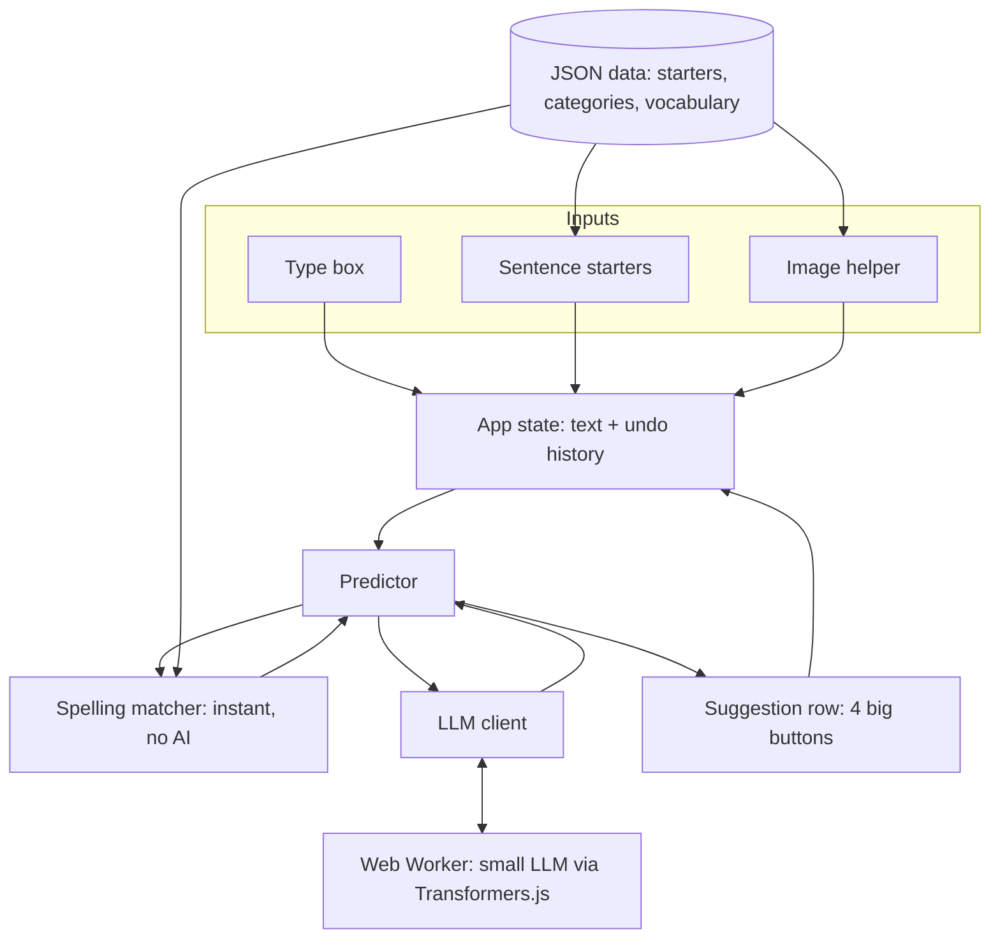

# Aphasia Writing Helper: Architecture

A draft web app (for a UX class) that helps people with Broca's (non-fluent) aphasia write short messages. They can start sentences with picture buttons, pick words from an image helper, type with spelling help, and get next-word suggestions from a small AI model that runs in the browser.

---

## Instructions for Claude Code

- **Goal:** build the app described below, following the build order in section 10. Finish each step and make sure the page works before starting the next.
- **Stack:** plain HTML, CSS and JavaScript (ES modules). No framework, no backend, no build step.
- **Running locally:** ES modules and Web Workers need a local server, e.g. `python3 -m http.server 8000`.
- **Browsers:** current Chrome, Edge, Firefox and Safari. Older browsers don't need support.
- **AI model:** Transformers.js, loaded inside a Web Worker (`new Worker(url, { type: "module" })`). Pin a specific library version. Use WebGPU when it's available, otherwise the CPU (WASM) fallback.
- **Scope:** this is a draft. Keep the code simple and readable, with comments explaining each module's job.
- **The app must work fully without the model.** The LLM only improves suggestions.
- **Privacy:** no server, no accounts, no analytics. Text never leaves the browser.

---

## 1. The homepage

One page, with everything visible at once:

```
┌──────────────────────────────────────────────────────┐
│  App name                                             │
├──────────────────────────────────────────────────────┤
│  TYPE BOX  [ I want coffee ▏                       ]  │
│  [Read aloud] [Undo] [Clear] [Copy]                   │
├──────────────────────────────────────────────────────┤
│  SUGGESTIONS   [ please ] [ with ] [ now ] [ water ]  │
├──────────────────────────────────────────────────────┤
│  SENTENCE STARTERS (picture + words)                  │
│  [I want] [I need] [I feel] [Can you] [Call] [Where is]│
├──────────────────────────────────────────────────────┤
│  IMAGE HELPER                                         │
│  Tabs: People | Food | Places | Feelings | Actions    │
│  [pic] [pic] [pic] [pic] [pic] [pic]                  │
└──────────────────────────────────────────────────────┘
```

Every input, whether typing, a starter or a picture, goes into the same type box, and the suggestion row updates after each change.

## 2. How the parts connect



**The rule that keeps it simple:** every input calls the same function, `insert(word)`. That function updates the text, saves an undo step and asks the predictor for new suggestions. Typing in the box calls `setText(value)`, which does the same except for inserting. Nothing else changes the text.

## 3. Folder structure

```
aphasia-helper/
├── index.html              ← the homepage layout
├── css/
│   └── styles.css          ← big buttons, high contrast
├── data/
│   ├── starters.json       ← sentence starters + icons
│   ├── categories.json     ← image helper words + pictures
│   └── vocab.json          ← word list + "likely next words"
├── images/                 ← SVG icons (simple placeholders are fine for the draft)
└── js/
    ├── app.js              ← startup: load data, wire everything
    ├── state.js            ← text, undo history, insert()
    ├── ui/
    │   ├── typeBox.js
    │   ├── suggestions.js
    │   ├── starters.js
    │   └── imageHelper.js
    ├── engine/
    │   ├── predictor.js    ← decides spelling vs. next word
    │   └── spelling.js     ← edit distance + sound-alike
    └── llm/
        ├── llmClient.js    ← talks to the worker
        └── llm.worker.js   ← loads and runs the model
```

## 4. What each part does

| Part | Job | Talks to |
|---|---|---|
| `state.js` | Holds `text` and `history`; exposes `insert()`, `setText()`, `undo()`, `clear()`, and a `subscribe()` so the UI re-renders on change | Every UI part, predictor |
| `typeBox.js` | Shows the text; on typing calls `state.setText()`; Read aloud uses the browser's `speechSynthesis`; Copy uses `navigator.clipboard` | state |
| `starters.js` | Draws 6 picture buttons from `starters.json`; tap → `insert("I want")` | state |
| `imageHelper.js` | Category tabs → grid of pictures from `categories.json`; tap → `insert("coffee")` | state |
| `predictor.js` | Looks at the last word and picks a mode (section 6), then merges results into 4 suggestions | spelling, llmClient |
| `spelling.js` | "cofee" or "kofi" → *coffee*, matched against `vocab.json` | predictor |
| `llmClient.js` | Sends text to the worker with a request id, drops outdated replies, reports `loading` / `ready` / `unavailable` | worker |
| `llm.worker.js` | Loads the model once and returns next-word guesses | llmClient |
| `suggestions.js` | Draws 4 big buttons; tap → `insert(word)` (in spelling mode, it replaces the unfinished word) | state |

## 5. Data formats

`data/starters.json`:
```json
[
  { "id": "want", "label": "I want", "icon": "images/cup.svg" },
  { "id": "need", "label": "I need", "icon": "images/help.svg" },
  { "id": "feel", "label": "I feel", "icon": "images/heart.svg" },
  { "id": "can",  "label": "Can you", "icon": "images/question.svg" },
  { "id": "call", "label": "Call", "icon": "images/phone.svg" },
  { "id": "where","label": "Where is", "icon": "images/pin.svg" }
]
```

`data/categories.json`:
```json
{
  "People":   [ { "word": "wife", "image": "images/wife.svg" } ],
  "Food":     [ { "word": "coffee", "image": "images/coffee.svg" },
                { "word": "water",  "image": "images/water.svg" } ],
  "Places":   [ { "word": "home", "image": "images/home.svg" } ],
  "Feelings": [ { "word": "tired", "image": "images/tired.svg" } ],
  "Actions":  [ { "word": "eat", "image": "images/eat.svg" } ]
}
```
Put 6–8 words in each category for the draft.

`data/vocab.json` gives the spelling matcher its words, plus backup next-word lists for when the model isn't ready:
```json
{
  "words": ["coffee", "water", "help", "wife", "doctor", "tired", "home", "please"],
  "next": {
    "want": ["coffee", "water", "to", "help"],
    "need": ["help", "my", "to", "water"],
    "feel": ["tired", "good", "sad", "pain"],
    "you":  ["help", "call", "come", "get"],
    "call": ["my", "wife", "son", "doctor"],
    "is":   ["my", "the"],
    "_default": ["please", "now", "today", "thank you"]
  }
}
```
Include every word that appears in starters and categories in `words`.

## 6. How prediction works

```
after every change to the text:
  if the text is empty:
      → show quick words: "Hello", "Yes", "No", "Thank you"
  else if the last word is unfinished (no space after it):
      → SPELLING mode: spelling.js finds the 4 closest words   (instant)
  else:
      → NEXT-WORD mode:
          1. show backup words from vocab.json right away
             (look up the last word in "next", else "_default")
          2. ask the LLM (after a 300 ms pause in typing)
          3. when it answers, swap in its words
             (unless the text has changed since)
```

### Spelling matcher (`spelling.js`)

- For each word in the vocabulary, score it against the unfinished word and take the 4 lowest scores, within a threshold of about half the typed word's length.
- The score is the smallest of:
  - the edit distance between the two words
  - the edit distance to the vocabulary word's beginning (same length as what was typed) + 0.5
  - the edit distance between their sound keys + 0.25
- **Sound key:** lowercase, `ph`→`f`, `ck`→`k`, `c`/`q`→`k`, collapse doubled letters, strip trailing vowels. This makes "kofi" and "coffee" both `kof`.
- Add a small penalty when the first letters differ.

### The LLM (`llm.worker.js`)

- **Model:** a small instruct model with an ONNX build on Hugging Face, around 0.5B parameters (Qwen or SmolLM class, or a newer equivalent), with quantized weights.
- **Loading:** start downloading in the background after the page opens. The browser caches it after the first visit. Report progress to the page; until it's ready, the backup lists are used. If loading fails, stay on the backup lists with no error popups.
- **Prompt (few-shot):**
  ```
  Give 5 likely next words for a short message. One per line.
  Message: I want
  coffee
  water
  to
  help
  food
  Message: Can you
  help
  call
  come
  get
  bring
  Message: {user text}
  ```
- **Generation settings:** a low `max_new_tokens` (about 20) and low temperature.
- **Cleaning the output (in `predictor.js`):** keep single words or two-word phrases, lowercase, drop duplicates and anything already shown, rank words found in `vocab.json` first, and cap the list at 4.
- **Later upgrade:** instead of asking the model to write a list, read its next-token probabilities directly. That's faster and more reliable, but takes more code.

## 7. Two example flows

**No typing:** tap **I want** → the box shows "I want " → the backup words *coffee, water, to, help* appear at once → the LLM refines them a moment later → tap **coffee** → tap **Read aloud** → tap **Copy**.

**Typing with mistakes:** type "kofi" → spelling mode offers *coffee* → tap it → "kofi" is replaced with "coffee", followed by a space → next-word mode starts.

## 8. Design rules

- Buttons at least about 64 px tall with generous spacing. Every button shows a picture plus a word.
- Large, very legible text (e.g. Atkinson Hyperlegible or a system font, 22 px or more for buttons and the type box).
- Strong contrast (at least 4.5:1) and a clearly visible focus outline.
- No timeouts and no auto-sending. Every change can be undone.
- Real `<button>` and `<input>` elements with labels; `aria-label` on icon-only controls.
- Short, plain labels. No paragraphs of instructions on the page.
- The layout stacks into one column on narrow screens.

## 9. What's out of scope for this draft

- Speech input
- Turning fragments into full sentences
- Personal vocabulary editing and saving
- Accounts, servers or syncing

## 10. Build order

Each step should leave a working page.

1. **Layout:** static `index.html` and `styles.css` with all five sections and placeholder buttons.
   *Done when:* the page matches the wireframe and stacks on a narrow window.
2. **State and inputs:** `state.js`, the type box, sentence starters and the image helper, loaded from the JSON files.
   *Done when:* tapping starters and pictures adds words to the box, and Undo and Clear work.
3. **Spelling suggestions:** `spelling.js`, `predictor.js` (spelling mode) and the suggestion row.
   *Done when:* typing "kofi" or "cofee" suggests *coffee*, and tapping it replaces the word.
4. **Backup next words:** next-word mode using `vocab.json`.
   *Done when:* tapping "I want" shows *coffee, water, to, help*.
5. **LLM:** the worker and `llmClient.js`, with the model's words replacing the backup lists and a small "AI loading / ready" status.
   *Done when:* suggestions change after the model loads, and the app still works with the model turned off.
6. **Polish:** Read aloud, Copy feedback ("Copied"), focus styles, and a final accessibility pass.
